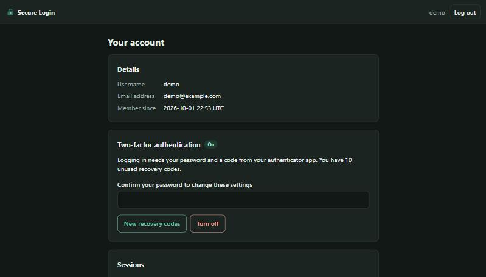

# Secure Login

[](https://github.com/TBAILIBILLAL/secure-login/actions/workflows/ci.yml)

A small web app that does one thing carefully: letting people register, log in and log
out. Passwords are hashed with Argon2id, every database query is parameterized, sessions
live on the server so that logging out really ends them, and accounts can be protected
with two-factor authentication from any authenticator app.



## What it does

| Feature | How |
|---|---|
| **Registration and login** | Username, email address and password. Log in with either the username or the email address |
| **Password hashing** | Argon2id with a random salt per password, at the cost recommended by RFC 9106 |
| **Input validation** | Each field is checked against what is allowed; anything else is refused with an explanation |
| **SQL injection protection** | Values are always passed to the database as parameters, never built into the SQL text |
| **Sessions** | A random token in a locked-down cookie; the session itself is stored on the server |
| **Logout** | Deletes the session on the server. Also "log out everywhere else" |
| **Two-factor authentication** | Time-based codes (TOTP) set up by QR code, plus ten single-use recovery codes |
| **Guessing protection** | Five failed attempts lock an account for up to 15 minutes; an address is limited too |
| **Forged requests (CSRF)** | Every form carries a token that other sites cannot read |
| **Injected scripts (XSS)** | All output is escaped, and a content security policy stops the browser running any script |

## Quick start

Requires Python 3.10 or newer.

On Windows, double-click `run.bat`. The first run installs the dependencies, then the
app opens in your browser.

On any system:

```bash
python -m venv .venv
```

```bash
.venv/bin/pip install -e .
```

```bash
.venv/bin/python -m secure_login --open
```

On Windows the two programs are `.venv\Scripts\pip` and `.venv\Scripts\python`.

The app runs at `http://127.0.0.1:5000`. Create an account, log in, and turn on
two-factor authentication from the account page with an authenticator app such as
Aegis, Google Authenticator or Microsoft Authenticator.

This way of running it is for trying it out on your own computer. See
[Running it for real](#running-it-for-real) before putting it on a network.

## How each protection works

### Passwords

Passwords are hashed with **Argon2id**, the recommended form of the algorithm that won
the Password Hashing Competition, through the `argon2-cffi` library. The settings are
64 MiB of memory, 3 passes and 4 lanes, which is the second recommended option of
RFC 9106. Needing that much memory for every guess is what makes guessing slow even on
graphics cards.

- Every hash has its own random salt, so equal passwords give different hashes.
- The settings are stored inside each hash. If they are raised later, a hash made with
  the old settings is replaced at that user's next login.
- A login for a name that does not exist still spends the time of a real check, and
  gets the same message as a wrong password. The answer does not reveal which accounts
  exist.
- Password rules favour length, as current NIST guidance does: at least 12 characters,
  no forced mix of symbols, not a common password, and not built on the username.

### Input validation and SQL injection

Input is checked in `validation.py` against what is allowed. A username is 3 to 32
ASCII letters, digits, dots, hyphens or underscores, so characters that merely look
like other letters cannot be used to imitate another user's name.

Validation is not what stops SQL injection. Parameterized queries do:

```python
db.execute("SELECT * FROM users WHERE username = ? OR email = ?", (identifier, identifier.lower()))
```

The SQL text is fixed, and the values travel separately, so the database can never
mistake a value for part of the command. No query in this project is built by joining
or formatting strings. The tests show this from both sides: classic injection strings
do not log anyone in, and an address such as `o'brien@example.com` is stored and found
again exactly as typed.

### Sessions and logout

After a login the browser holds a random 256-bit token and the database holds its
SHA-256 hash. Each request looks the token up.

- **Logout deletes the session on the server.** A copy of the cookie taken before the
  logout stops working, which is not the case when the session lives only in a cookie.
- A session ends after 30 minutes without use and after 12 hours in any case.
- Logging in issues a new token and discards everything from before the login, so a
  token planted in the browser beforehand gains nothing (session fixation).
- The cookie is `HttpOnly` (hidden from scripts), `Secure` (HTTPS only),
  `SameSite=Lax`, and named with the `__Host-` prefix, which binds it to this exact host.
- The account page lists the active sessions and can end all the others.

### Two-factor authentication

Setup shows a QR code for an authenticator app and is finished by entering the
password and a first code. After that, a login needs the password and a 6-digit code
that changes every 30 seconds (TOTP, RFC 6238).

- A code is accepted only once, so a code seen over someone's shoulder is useless.
- The codes for the half minute before and after are accepted, to allow for clocks
  that are slightly off.
- Ten recovery codes are shown once at setup, for a lost phone. Each works a single
  time, and only their hashes are stored.
- Wrong codes count as failed attempts like wrong passwords do.
- Turning two-factor off, or making new recovery codes, asks for the password again,
  so a stolen session alone cannot remove the protection.

### Guessing, forged requests and injected scripts

- **Guessing.** Failed attempts are counted per account and per network address over
  15 minutes. Five failures lock the account and twenty lock the address; while locked,
  even the correct password is refused.
- **CSRF.** Every form includes a random token tied to the session, and a request that
  changes anything is refused without it. Logging out is a form too, so a link cannot
  log anyone out.
- **XSS.** Templates escape everything they print. In addition the content security
  policy allows no script at all (the app uses none), so injected markup would not run.
- Other headers forbid framing by other sites, keep pages out of caches, and tell
  browsers to insist on HTTPS.

## Running it for real

`python -m secure_login` serves plain HTTP on the loopback address, with the cookie's
`Secure` flag switched off so that this works. For anything else, run the app with a
production server behind HTTPS. Used that way, the cookie is `Secure` by default:

```bash
pip install waitress
```

```bash
waitress-serve --listen=127.0.0.1:8000 --call secure_login:create_app
```

Put a reverse proxy that terminates HTTPS (Caddy, nginx) in front of it, and set:

| Variable | Purpose |
|---|---|
| `SECURE_LOGIN_SECRET_KEY` | The key that signs the cookie. If unset, one is generated and kept in `instance/secret_key` |
| `SECURE_LOGIN_DB` | Path of the SQLite database. Default: `instance/secure_login.db` |
| `SECURE_LOGIN_PROXIES` | The number of reverse proxies in front of the app, so that it sees the real client address. Default: 0 |

The `instance` folder holds the database and the signing key and is not part of the
repository.

## Project layout

```
secure_login/
  __init__.py      the app: configuration, cookie settings, error pages
  __main__.py      runs it locally
  views.py         the pages: register, login, code step, account, logout
  validation.py    rules for usernames, email addresses and passwords
  passwords.py     Argon2id hashing
  sessions.py      server-side sessions
  throttle.py      limits on failed attempts
  twofactor.py     TOTP codes, the QR code and recovery codes
  security.py      CSRF tokens and security headers
  db.py            SQLite connection
  schema.sql       the four tables
  templates/       the pages (Jinja)
  static/          the stylesheet and icon
tests/             86 tests
```

About 810 lines of Python. Dependencies: Flask, argon2-cffi, pyotp and segno.

## Tests

```bash
python -m unittest discover -s tests -t .
```

The tests drive the app the way a browser would. They cover validation, hashing,
registration and login, SQL injection strings, lockouts, the cookie's flags, session
expiry, logout (including a cookie copied before logout), CSRF, the security headers,
and the whole two-factor flow including reused codes and recovery codes.

## Limitations

- **No email is sent.** There is no address verification and no password reset, and no
  form for changing a password. One consequence is that the registration form says when
  a username or address is already taken.
- **The two-factor key is stored as it is.** The server needs the key itself to check
  codes, so it cannot be hashed. A real deployment should encrypt it with a key kept
  outside the database.
- **The common-password list is short.** A real deployment should check new passwords
  against a list of breached passwords.
- **Locking can be abused.** Someone who knows a username can keep that account locked
  by failing on purpose. This is the usual price of a lock; the alternative is to slow
  attempts down instead of refusing them.
- **Registration is not rate limited.**
- **SQLite and one server.** Fine for a demonstration and for small sites; several
  servers would need a shared database.

## Licence

Released under the [MIT License](LICENSE).
